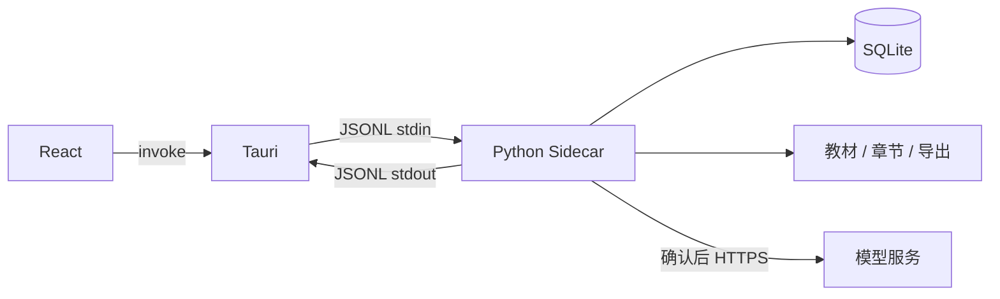

# 系统架构

React 19 / TypeScript 负责界面；Tauri 2 Rust 壳负责固定 Python Sidecar 的生命周期、IPC 和原生文件对话框；Python 负责 PDF、SQLite、AI、笔记、导出。

| 目录 | 责任 |
| --- | --- |
| apps/desktop/src/features | 按产品功能组织页面 |
| apps/desktop/src/services | 协议验证与后端通信 |
| apps/desktop/src-tauri | 窗口、权限、Sidecar 和打包 |
| backend/src/studynote/ipc | 方法白名单、参数检查和消息封装 |
| core | 配置和工作区组成 |
| documents / storage | 导入、摘要去重、分章和托管路径 |
| ai | 服务适配、凭据、缓存和预算 |
| notes / knowledge / search | 历史、主题和文字搜索 |
| tasks | 单线程后台任务、状态查询 |
| database | 仓储、事务和迁移 |
| backup / export | SQLite 快照、ZIP 和 Markdown |
| packages/contracts | 共享类型及 JSON Schema |

生产环境不启动 HTTP 服务。Rust 只转发固定 backend_request，前端无任意 Shell 权限。请求按 ID 匹配，180 秒超时。AI 任务通过轮询更新，应用退出终止 Sidecar。任务状态在内存中，重启不自动恢复；费用预留持久化。

开发桥接只监听 127.0.0.1，随机令牌与固定 Vite Origin 保护访问。共享 Schema 同步到 Python 包，并由测试校验一致性。Markdown 不启用原始 HTML。Windows DPAPI Key 文件不进入备份。
